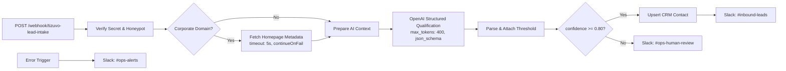

# Blueprint 01: Lead Enrichment & CRM Sync

Automatically verify, enrich, and score inbound B2B leads from your website form — syncing high-confidence leads into HubSpot/Pipedrive while routing ambiguous or low-confidence submissions to `#ops-human-review` so your CRM stays clean.

## Architecture



## AI Output Schema

The `AI Lead Qualification` node enforces OpenAI Structured Outputs (`strict: true`, `max_tokens: 400`):

```json
{
  "fit_score": 88,
  "recommended_service": "AI Operations & CRM Automation",
  "priority": "high",
  "confidence": 0.91,
  "summary": "VP of Operations at a logistics company processing 400 weekly freight quotes with clear budget and HITL automation requirements."
}
```

## Guardrails Built In

- **Webhook authentication & spam filtering:** Rejects requests with a missing or invalid `X-Webhook-Secret` header and silently drops bot submissions where the `website` honeypot field is non-empty.
- **Graceful enrichment degradation:** Skips homepage scraping for consumer email domains (`gmail.com`, `outlook.com`, etc.) and sets `timeout: 5000` with `continueOnFail: true` so slow prospect sites never block intake.
- **Strict confidence gate:** Only leads with `confidence >= AI_CONFIDENCE_THRESHOLD` (default `0.80`) create or update CRM records.
- **Error alerting:** Any unhandled runtime error triggers `#ops-alerts` with execution ID and failing node details.

## Setup

1. Import [`workflow.json`](./workflow.json) into n8n (**Workflows → Import from File**).
2. Configure environment variables from [`.env.example`](../../.env.example):
   - `LEAD_WEBHOOK_SECRET`
   - `OPENAI_API_KEY` and `OPENAI_MODEL` (default `gpt-4o-mini`)
   - `AI_CONFIDENCE_THRESHOLD` (default `0.80`)
   - `CRM_API_BASE_URL` and `CRM_API_TOKEN`
   - `SLACK_LEADS_CHANNEL`, `SLACK_HUMAN_REVIEW_CHANNEL`, `SLACK_OPS_ALERT_CHANNEL`
3. Connect your **Slack API** credential on the Slack nodes.
4. Activate the workflow.

## Test with `curl`

```bash
curl -X POST "https://your-n8n-instance.example.com/webhook-test/tizuvo-lead-intake" \
  -H "Content-Type: application/json" \
  -H "X-Webhook-Secret: $LEAD_WEBHOOK_SECRET" \
  -d @workflows/01-lead-enrichment-crm-sync/sample-payload.json
```
