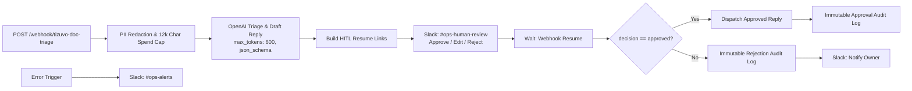

# Blueprint 02: Document Triage & Human-in-the-Loop (HITL)

Triage inbound support tickets or customer documents with strict pre-LLM PII redaction, a hard input spend cap, and a **mandatory Human-in-the-Loop (HITL) Slack approval gate** so no external customer reply is ever dispatched autonomously.

## Architecture



## Guardrails Built In

- **Pre-LLM PII Scrubbing:** Masks credit card numbers (`[REDACTED_CARD]`), SSNs/formatted national IDs (`[REDACTED_ID]`), and `Bearer` authorization tokens (`Bearer [REDACTED_TOKEN]`) before any text leaves your infrastructure.
- **Per-Run Spend Cap:** Rejects documents longer than `AI_MAX_INPUT_CHARS` (default `12,000` characters) before calling OpenAI and caps generation at `max_tokens: 600`.
- **Mandatory HITL Approval Gate:** Uses n8n's `Wait` (webhook resume) node paired with Slack approval links. Even high-confidence drafts cannot reach external customers without an explicit human `approved` decision.
- **Immutable Audit Trail:** Both approved and rejected decisions post a structured record with execution ID, category, confidence score, and redaction count to `AUDIT_LOG_WEBHOOK_URL`.

## Setup

1. Import [`workflow.json`](./workflow.json) into n8n (**Workflows → Import from File**).
2. *(Optional)* Swap the Webhook trigger for a Gmail or IMAP Email Trigger node if ingesting directly from a shared inbox.
3. Configure environment variables from [`.env.example`](../../.env.example):
   - `DOC_TRIAGE_WEBHOOK_SECRET`, `AI_MAX_INPUT_CHARS`, `AI_CONFIDENCE_THRESHOLD`
   - `OPENAI_API_KEY`, `OPENAI_MODEL`
   - `REPLY_DISPATCH_URL`, `REPLY_DISPATCH_TOKEN`
   - `AUDIT_LOG_WEBHOOK_URL`, `AUDIT_LOG_TOKEN`
   - `SLACK_HUMAN_REVIEW_CHANNEL`, `SLACK_OPS_ALERT_CHANNEL`
4. Connect your **Slack API** credential and activate the workflow.

## Test with `curl`

```bash
curl -X POST "https://your-n8n-instance.example.com/webhook-test/tizuvo-doc-triage" \
  -H "Content-Type: application/json" \
  -H "X-Webhook-Secret: $DOC_TRIAGE_WEBHOOK_SECRET" \
  -d @workflows/02-document-triage-hitl/sample-payload.json
```
