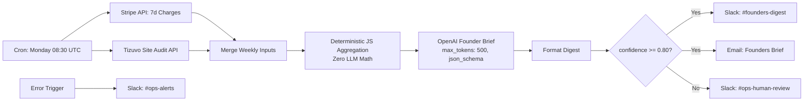

# Blueprint 03: Weekly Revenue & Site Health Digest

Every Monday at 08:30 UTC, pull 7-day Stripe revenue metrics in parallel with a live [`@tizuvo/audit`](https://github.com/tizuvo/site-audit-cli) security/SEO/performance check, compute all totals deterministically in JavaScript, and deliver a grounded 5-bullet founder brief to Slack `#founders-digest` and email.

## Architecture

## Grounding & Reliability Rules

- **Zero LLM arithmetic:** `Deterministic Metrics Aggregation` computes gross revenue, paid charge counts, failed payment counts, failed volume, and failed site audit checks in plain JavaScript before OpenAI is called.
- **Strict schema & token cap:** `AI Executive Brief` enforces `max_tokens: 500`, `temperature: 0.1`, and `response_format: json_schema` returning exactly 5 bullets and 1–3 action items.
- **Incomplete-data gate:** If an upstream API fails or returns partial data, the model lowers `confidence` below `AI_CONFIDENCE_THRESHOLD` (`0.80`) and the brief is routed to `#ops-human-review` instead of emailing founders.
- **Least-privilege Stripe access:** Use a Stripe restricted key with read-only `charges:read` (and `invoices:read` if extended) permissions.

## Setup

1. Import [`workflow.json`](./workflow.json) into n8n (**Workflows → Import from File**).
2. Configure environment variables from [`.env.example`](../../.env.example):
   - `STRIPE_API_KEY` (restricted read-only key)
   - `AUDIT_TARGET_URL` and `TIZUVO_AUDIT_ENDPOINT` (defaults to `https://tizuvo.com/api/audit`)
   - `OPENAI_API_KEY`, `OPENAI_MODEL`, `AI_CONFIDENCE_THRESHOLD`
   - `SLACK_FOUNDERS_CHANNEL`, `SLACK_HUMAN_REVIEW_CHANNEL`, `SLACK_OPS_ALERT_CHANNEL`
   - `DIGEST_SENDER_EMAIL`, `DIGEST_RECIPIENT_EMAIL`
3. Connect your **Slack API** and **SMTP** credentials in n8n.
4. To test manually without waiting for Monday, pin [`sample-payload.json`](./sample-payload.json) onto the `Deterministic Metrics Aggregation` node in n8n and click **Test Workflow**.
